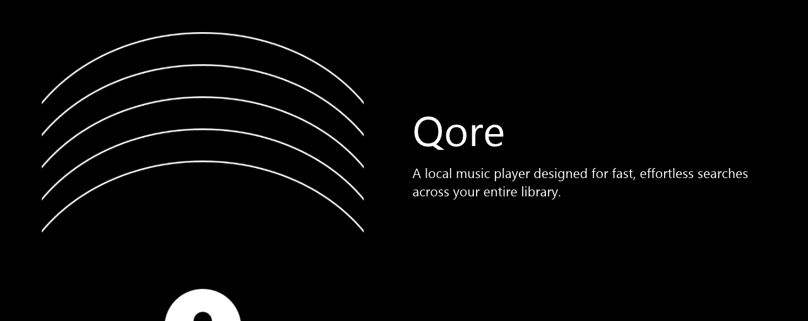
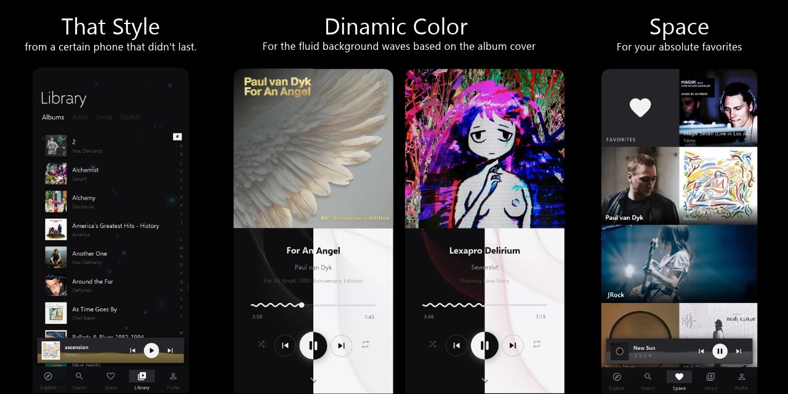
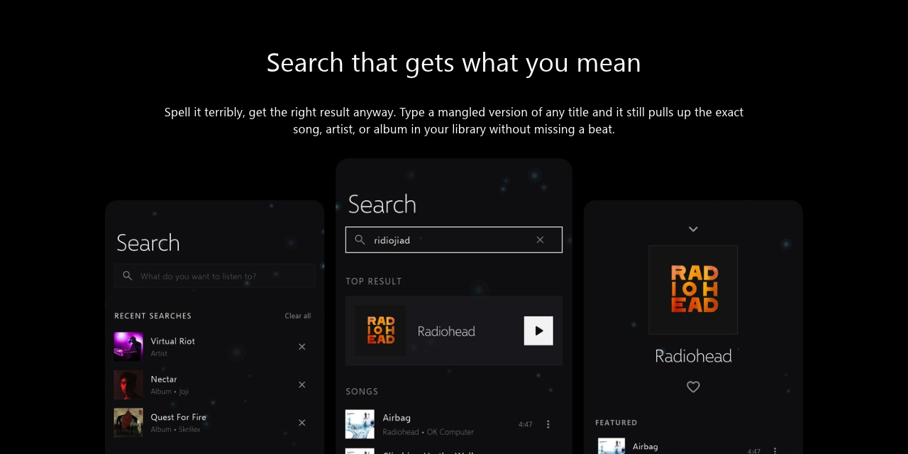

  

   
   

  

    
    
  

  

    Qore is a local Android music player built to deliver a smooth, comfortable search experience paired with a clean, modern visual identity. Thanks to its smart search engine, you can find any of your tracks, albums, and artists from a single text box—just like Spotify, but for your local library and without needing an account.
  

---

## Miss the Metro style? Me too!

The design language is heavily inspired by Windows Phone Metro, blended with the iconic ambient wave aesthetic of a certain Japanese company back in 2007.

### Dynamic Color

The fluid background waves and MiniPlayer progress fill dynamically adapt to the colors extracted from the currently playing album cover, while their motion smoothly responds to the track's tempo.

### Space *(because I couldn't think of a better name)*

Just like Windows Phone, Qore uses live tiles of different sizes to showcase your pinned music in a clean and engaging layout.

  

---

## Smart Search

No more dropdown menus or annoying filters. Type whatever you want, however you want, and Qore will find it.

  

---

## Additional Features

- **Bilingual:** Full support for **English** and **Spanish** (for now).
- **Gapless Playback & Silence Trimming:** Continuous playback buffer with automatic leading-silence trimming (including MP3, FLAC, and more), toggleable in Settings.
- **Adaptive Player Waves:** Background waves in the expanded player dynamically adapt to the current song's cover art colors and tempo.
- **Local Backup:** Export and import your listening stats, favorites, playlists, and Space layout as a JSON file.

---

## Permissions

This lists all permissions used by Qore as defined in [AndroidManifest.xml](./android/app/src/main/AndroidManifest.xml).

<table>
  <thead>
    <tr>
      <th>Category</th>
      <th>Permission</th>
      <th>Constraint</th>
      <th>Purpose</th>
    </tr>
  </thead>
  <tbody>
    <!-- Storage Permissions -->
    <tr>
      <td rowspan="3">Storage</td>
      <td><code>READ_MEDIA_AUDIO</code></td>
      <td>
        <a href="https://developer.android.com/reference/android/Manifest.permission#READ_MEDIA_AUDIO">Android 13+</a>
      </td>
      <td rowspan="2">To read, index, and play your local music files.</td>
    </tr>
    <tr>
      <td><code>READ_EXTERNAL_STORAGE</code></td>
      <td>
        <a href="https://developer.android.com/reference/android/Manifest.permission#READ_EXTERNAL_STORAGE">Before Android 13</a>
      </td>
    </tr>
    <tr>
      <td><code>WRITE_EXTERNAL_STORAGE</code></td>
      <td>
        <a href="https://developer.android.com/reference/android/Manifest.permission#WRITE_EXTERNAL_STORAGE">Before Android 11</a>
      </td>
      <td>To save user data backups or files to storage on older Android versions.</td>
    </tr>
    <!-- Services Permissions -->
    <tr>
      <td rowspan="3">Services</td>
      <td><code>FOREGROUND_SERVICE</code></td>
      <td rowspan="3">—</td>
      <td rowspan="3">Enables audio playback while the app is in the background or the screen is off.</td>
    </tr>
    <tr>
      <td><code>FOREGROUND_SERVICE_MEDIA_PLAYBACK</code></td>
    </tr>
    <tr>
      <td><code>WAKE_LOCK</code></td>
    </tr>
    <!-- Notification Permissions -->
    <tr>
      <td>Notifications</td>
      <td><code>POST_NOTIFICATIONS</code></td>
      <td>
        <a href="https://developer.android.com/develop/ui/views/notifications/notification-permission#exemptions-media-sessions">Android 13+</a>
      </td>
      <td>Displays media playback controls in the notification shade and lock screen.</td>
    </tr>
  </tbody>
</table>

---

## Privacy Policy

Qore operates **100% offline** on your device:

- **No data collection:** Qore does not collect, store, transmit, or share any personal data, usage analytics, crash reports, or telemetry.
- **No network access:** The app does not request the INTERNET permission and never connects to external servers.
- **Local storage only:** Your music index, album artwork cache, playlists, favorites, Space pins, and listening statistics are stored strictly in local storage on your device (and only exported when you manually choose to save a JSON backup).
- **Permissions:** Audio storage and notification permissions are used solely to scan local audio files and display system media playback controls.

---

## License

This project is licensed under the **GNU General Public License v3.0 (GPL-3.0)** — see the [LICENSE](./LICENSE) file for details.
